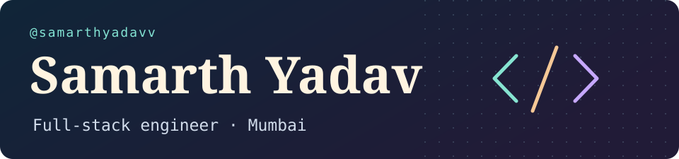
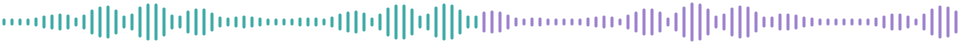

 &nbsp;  &nbsp; 

## 🌐 Merged contributions

I contribute to **ttt**, a terminal text editor. Three changes I've shipped cover editing behavior, command discovery and plugin testing.

| Contribution | What changed |
| --- | --- |
| [Multi-cursor clipboard editing](https://github.com/eugenioenko/ttt/pull/1095) | Made copy, cut and paste work across multiple cursors, including selections made in different directions. |
| [Plugin commands in the palette](https://github.com/eugenioenko/ttt/pull/1552) | Added the plugin name to each plugin command so users can tell where a command comes from. |
| [Per-user plugin settings](https://github.com/eugenioenko/ttt/pull/1622) | Added functional tests that disable a plugin for one user, restart the editor and check that another user's settings stay intact. |

## 🛠️ Product engineering

At **ProjectBoard**, I worked across the Vue frontend and Go backend on tools for teachers and students. I added in-app and email notifications when teachers added students to a class, and updated class access checks to account for ownership and group membership.

I also built a **React admin dashboard** with charts, a calendar and a Kanban board using Syncfusion and Tailwind CSS. [Explore the dashboard](https://react-admin-dashboard-2-l7nd6kc0f-samarthyadavv.vercel.app/)

## 💻 My stack

<table align="center">
<tr>
  <td align="center" width="120"> <strong>Go</strong></td>
  <td align="center" width="120"> <strong>Node.js</strong></td>
  <td align="center" width="120"> <strong>TypeScript</strong></td>
  <td align="center" width="120"> <strong>React</strong></td>
  <td align="center" width="120"> <strong>Vue</strong></td>
  <td align="center" width="120"> <strong>Tailwind CSS</strong></td>
</tr>
<tr>
  <td align="center" width="120"> <strong>MySQL</strong></td>
  <td align="center" width="120"> <strong>PostgreSQL</strong></td>
  <td align="center" width="120"> <strong>MongoDB</strong></td>
  <td align="center" width="120"> <strong>Redis</strong></td>
  <td align="center" width="120"> <strong>Docker</strong></td>
  <td align="center" width="120"> <strong>AWS</strong></td>
</tr>
</table>

## 🥋 Beyond engineering

I earned a **national karate gold medal (KAI, 2021)** and a **first-dan black belt**. As a yoga club director, I trained more than 100 people.

