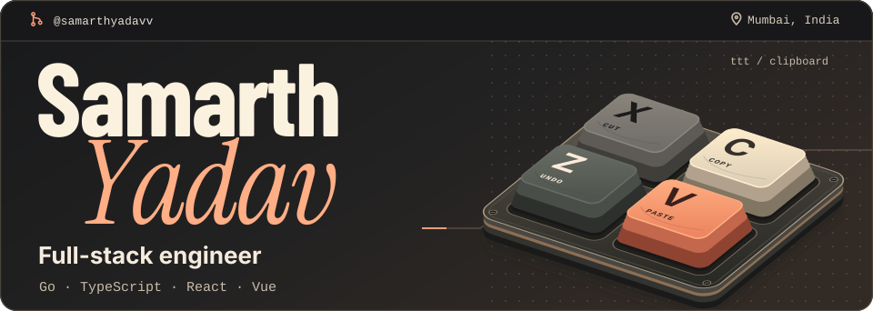
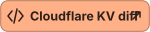

<h1>
<picture>
  <source media="(max-width: 767px)" srcset="https://raw.githubusercontent.com/samarthyadavv/samarthyadavv/main/assets/macropad-mobile.svg" />
  
</picture>
</h1>

I build Python backends for model evaluation and document search. My merged work includes **two fixes in Cloudflare Workers SDK** and **four contributions to the ttt editor**. I’m based in Mumbai and open to remote backend, full-stack, and developer-tooling roles.

  
  
  
  

## Two cursors, one undo

In ttt, the status bar could show two cursors while Paste changed text at only the primary one. I made the editor give each cursor one clipboard line when the counts match. It merges overlapping selections and applies edits from the bottom up so an insertion can’t shift the next target. The whole paste goes onto the undo stack as one edit.

<a href="https://github.com/eugenioenko/ttt/blob/e83e9fc22a30ba9b652227ca6b4f6d4363f80237/internal/ui/editor_widget_multicursor_clipboard_test.go#L171-L219">
<picture>
  <source media="(max-width: 767px)" srcset="https://raw.githubusercontent.com/samarthyadavv/samarthyadavv/main/assets/clipboard-mobile.svg" />
  
</picture>
</a>

[Read the Go regression tests](https://github.com/eugenioenko/ttt/blob/e83e9fc22a30ba9b652227ca6b4f6d4363f80237/internal/ui/editor_widget_multicursor_clipboard_test.go#L171-L219)

Inspect the clipboard values

The two cursors sit after `a` and `x`.

| Action | First line | Second line |
| --- | --- | --- |
| Before | `abc` | `xyz` |
| Paste `Q\nR` | `aQbc` | `xRyz` |
| Undo once | `abc` | `xyz` |

## More work merged upstream

- **Miniflare** now passes JSON and metadata options through local KV bulk reads, so callers can retrieve parsed values and per-key metadata together. [KV bulk-read patch](https://github.com/cloudflare/workers-sdk/pull/17101)
- **Wrangler** now exits with status `1` when the Basin SQL service rejects a query, so shell scripts can detect the failure and read the database errors on stderr. [CLI error-handling patch](https://github.com/cloudflare/workers-sdk/pull/17102)
- **ttt** completes filesystem paths in the background and discards a directory listing if the cursor moves before it arrives. [Path completion patch](https://github.com/eugenioenko/ttt/pull/1668)

Two more merged ttt patches

- Added the owning plugin’s name to command-palette entries while keeping commands searchable by their original titles. [Command discovery](https://github.com/eugenioenko/ttt/pull/1552)
- Tested per-user plugin settings across editor restarts, including isolation between two users sharing the same plugin installation. [Plugin settings tests](https://github.com/eugenioenko/ttt/pull/1622)

## Backends and product work

- **Gauge AI** compares completed model runs with matching dataset fingerprints and shows both outputs for each prompt that changed from passing to failing. [Comparison endpoint](https://github.com/samarthyadavv/gauge-ai/blob/bf1635f2254305080a4b1846a39c5fafb35bf8d3/backend/app/main.py#L451-L482)
- **Sentinel** checks the workspace on both a passage and its parent document before ranking the passages by vector distance for a cited answer. [Retrieval query](https://github.com/samarthyadavv/sentinel/blob/82bc3b09726774a1535a2ff644ed068ddeb43093/backend/app/main.py#L441-L459)
- At **ProjectBoard**, I implemented classroom workflows in Vue, class-edit permission checks in Go, and the in-app and email notifications students received when a teacher added them to a class. [ProjectBoard](https://projectboard.world/)

## Patches in progress

- **Open · llama.cpp** — I proposed replacing recursive graph traversal with an explicit stack and splitting a WebGPU lookup table to fit WebKit’s limit. [Graph and shader patch](https://github.com/ggml-org/llama.cpp/pull/32913)
- **Draft · Gitea** — My repository-list API change uses the repository ID to break ties between timestamps so pagination stays consistent. [Repository sorting proposal](https://github.com/go-gitea/gitea/pull/40378)
