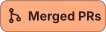
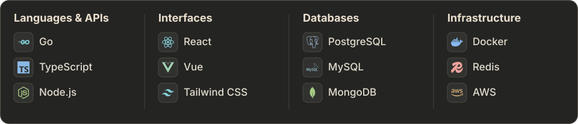
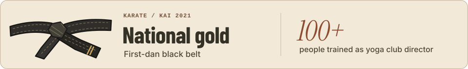

<picture>
  <source media="(max-width: 767px)" srcset="https://raw.githubusercontent.com/samarthyadavv/samarthyadavv/main/assets/macropad-mobile.svg" />
  
</picture>

  
  
  

## ⌨️ Open source

I contribute to **ttt**, a terminal text editor written in Go. My clipboard patch handles overlapping selections and distributes pasted lines across matching cursors. A single undo reverses the whole edit.

<a href="https://github.com/eugenioenko/ttt/pull/1095">
<picture>
  <source media="(max-width: 767px)" srcset="https://raw.githubusercontent.com/samarthyadavv/samarthyadavv/main/assets/clipboard-mobile.svg" />
  
</picture>
</a>

[Read the merged patch · #1095](https://github.com/eugenioenko/ttt/pull/1095) · [Jump to the Go undo test](https://github.com/eugenioenko/ttt/blob/e83e9fc22a30ba9b652227ca6b4f6d4363f80237/internal/ui/editor_widget_multicursor_clipboard_test.go#L205)

- **Command discovery** — I added plugin names to palette entries so users can tell which plugin owns a command. Search still finds it by its original title. [Merged PR #1552](https://github.com/eugenioenko/ttt/pull/1552)
- **Plugin settings** — I added functional tests that disable a plugin for one user, restart the editor and check that a second user's plugins still work. [Merged PR #1622](https://github.com/eugenioenko/ttt/pull/1622)

## 🛠️ Product engineering

**ProjectBoard** · Go, Vue, MySQL  
I built the in-app and email notifications students receive when a teacher adds them to a class. I also updated the Go permissions checks for class edits to account for ownership and group membership.

**React Admin Dashboard** · React, Syncfusion, Tailwind CSS  
I built a dashboard with charts, a scheduling calendar and a Kanban board, with light and dark themes across views. [Source code](https://github.com/samarthyadavv/React-Admin-Dashboard) · [Dashboard demo](https://react-admin-dashboard-2-l7nd6kc0f-samarthyadavv.vercel.app/)

## 🧰 My stack

<picture>
  <source media="(max-width: 767px)" srcset="https://raw.githubusercontent.com/samarthyadavv/samarthyadavv/main/assets/stack-mobile.svg" />
  
</picture>

## 🥋 Karate &amp; coaching

<picture>
  <source media="(max-width: 767px)" srcset="https://raw.githubusercontent.com/samarthyadavv/samarthyadavv/main/assets/karate-mobile.svg" />
  
</picture>
